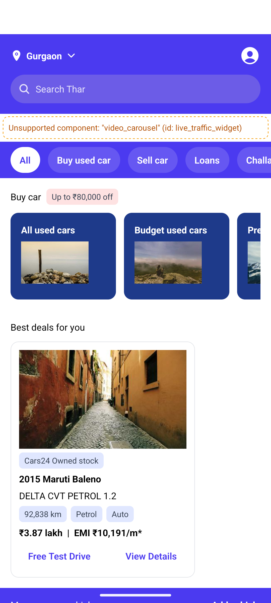
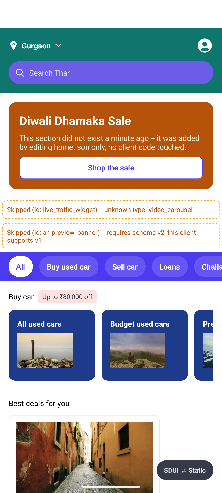
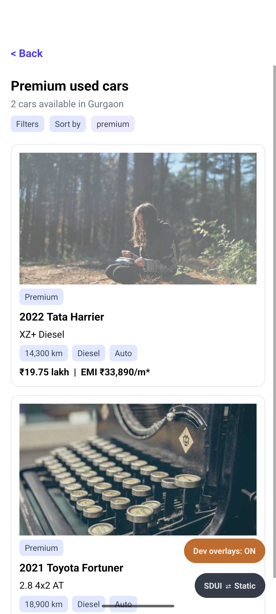
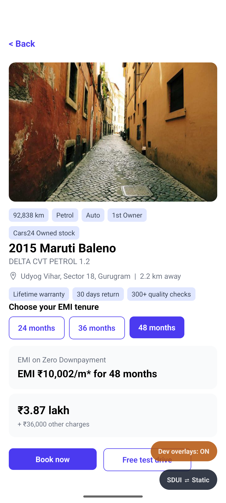

# Cars24 Home — Server-Driven UI in React Native

> The entire Cars24 home page rendered from **one JSON payload** through a generic component registry: change the JSON and the screen changes, with no app release needed.


<table>
  <tr>
    <td align="center"><br><sub><b>Home</b>, 13 sections from JSON</sub></td>
    <td align="center"><br><sub><b>Live edit</b>: new banner, zero code</sub></td>
    <td align="center"><br><sub><b>Param-driven listing</b> screen</sub></td>
    <td align="center"><br><sub><b>EMI tenure selector</b> (computed)</sub></td>
  </tr>
</table>

🎥 **Demo video:** [`docs/demo-recording/demo.mp4`](docs/demo-recording/demo.mp4)

## Highlights

| | |
|---|---|
| 🧩 **13 generic primitives** | `stack · row · carousel · grid · list · text · image · icon · badge · button · divider · spacer · tappable`. There is no `carCard` type: every section is composed from these. |
| ⚡ **Action system** | `navigate · openUrl · openSheet · call · setState · toggleState · composite`, all through a single `dispatch()` |
| 🔀 **Conditional UI** | `visibleIf` + client state powers tabs, chips and the EMI selector without new component types |
| 🛡️ **Safe versioning** | `minVersion` per node, so unknown or too-new components fall back gracefully instead of crashing |
| 🌐 **Mock server + cache** | async, param-keyed screen JSON (`budget` vs `premium` return different cars) with a screen cache |
| 📊 **Measured, not guessed** | release-build Static-vs-SDUI benchmark: TTR **+8%**, TTI **+5%**, no scroll jank ([PERF.md](PERF.md)) |
| 🤖 **AI-assisted build** | built agentically with Claude Code, including emulator driving via `adb`. Full log in [AI_WORKFLOW.md](AI_WORKFLOW.md) |

## Tech stack

| Area | Used |
|---|---|
| Framework | React Native 0.86 · Expo SDK 57 · React 19 |
| Language | TypeScript 6 |
| UI | Custom JSON renderer · `@expo/vector-icons` (Ionicons) |
| State / actions | React Context (`SduiProvider`): state bag, nav stack, sheet slot |
| Perf tooling | Custom TTR/TTI marks · rAF scroll-jank tracker · `adb logcat` |
| Testing ground | Android emulator (Pixel 7, Android 16), release builds |

---

<details>
<summary><b>📖 Full design write-up</b> (screen choice, architecture, schema, versioning, trade-offs)</summary>


Server-Driven UI system for the Cars24 home/landing page — the page is rendered
entirely from a JSON payload by a generic component registry, not hardcoded
per-screen. Built in React Native (Expo, TypeScript).

## Which screen, and why

**The Cars24 home/landing page**, as suggested by the brief. Explored the
real app on an Android emulator (see `docs/screen-inventory.md` and
`docs/reference-screenshots/`) and inventoried **13 visually distinct
section types**: header/search, an in-place tab selector, five horizontal
rails (buy-car categories, car listings, showrooms, trending new cars,
marketing banners), a 2×3 grid, a promo banner, and a footer. That's well
past the brief's 5-section bar, includes both a rail and a grid, and the tab
selector gave a real, observed (not invented) SDUI-action pattern to build
against.

Picking the home page was also the more useful choice for the round-1
"different screen" test: it's the richest single page in the app, so the
schema had to earn broad primitives rather than section-specific ones from
the start, which is exactly what's needed to generalize to a screen we
haven't seen.

## Setup

```bash
npm install
npm run android   # or: npm run ios / npm run web
```

Requires an Android emulator (or device) already running for `npm run
android`. The app defaults to the SDUI-rendered home screen; a small toggle
button (bottom-right) switches to the static hardcoded twin for comparison
— see the perf-measurement caveat about that toggle in `PERF.md`.

## Architecture overview

```
src/
  schema/
    types.ts     # Node, Action, Condition, StyleProps -- the schema's shape
    version.ts   # CLIENT_SCHEMA_VERSION, for the versioning fallback
  renderer/
    Renderer.tsx        # the component registry (a Set + switch) + tree walker
    UnknownComponent.tsx # fallback for unknown type OR unsupported minVersion
    evalCondition.ts     # visibleIf evaluation
    styleUtils.ts         # StyleProps -> RN style objects
    ButtonView.tsx        # the one content primitive complex enough to split out
  actions/
    context.tsx  # SduiProvider: holds client state, nav stack, active sheet;
                 # dispatch() interprets Action objects
  screens/
    sdui/HomeScreen.tsx      # SDUI-rendered screen (reads src/data/home.json)
    static/StaticHomeScreen.tsx  # hardcoded twin, same content, no JSON/registry
  data/home.json  # the actual JSON payload for the home screen
  perf/           # TTR/TTI marks + scroll-jank tracker, shared by both screens
docs/
  screen-inventory.md, SCHEMA.md, reference-screenshots/  # research + design notes
```

**Component registry** lives directly in `renderer/Renderer.tsx` as a
`Set<string>` of known types plus a `switch` that maps each to its RN
output. This was a deliberate simplification: with 13 types the extra
indirection of a separate `registry/` map-of-constructors module didn't
earn its complexity over a switch statement -- if the registry grows
significantly, extracting one is the obvious next refactor, and nothing
about the schema depends on it staying a switch.

**Render flow:** `HomeScreen` reads `home.json`, and for each top-level
section calls `RenderNode`. `RenderNode` checks `visibleIf` (skip if false),
checks `minVersion` against `CLIENT_SCHEMA_VERSION` (fall back if the node
needs a newer client than this), renders the node's content via the
registry switch, and wraps it in a `Pressable` if the node has `onTap`.
Container types (`stack`, `row`, `carousel`, `grid`, `list`) recurse by
calling `RenderNode` again on their `children`.

**Actions:** `SduiProvider` (`actions/context.tsx`) owns three pieces of
state -- a generic `state: Record<string, unknown>` bag (for
`setState`/`toggleState`, read by `visibleIf`), a navigation stack (for
`navigate`), and an active-sheet slot (for `openSheet`) -- plus `openUrl`
and `call`, which just shell out to `Linking`. `dispatch(action)` is the
single entry point every `onTap` calls.

**Unknown-component fallback:** `renderer/UnknownComponent.tsx` is reached
two ways -- an unregistered `type`, or a registered `type` whose
`minVersion` is newer than this client supports. In dev it renders a
visible, labeled placeholder (so the fallback is demonstrable); in
production it renders `null`. Two live demo nodes exercise both paths in
`src/data/home.json`: `live_traffic_widget` (type `video_carousel`, not in
the registry) and `ar_preview_banner` (`minVersion: 2`, current client is
v1).

## Schema design rationale

The core bet: **13 generic layout + content primitives, not one component
per visual section.** No `carCard`, no `loanRail`, no `showroomCard` type
exists anywhere -- every one of the 13 sections on the real home page is
composed from `stack`/`row`/`carousel`/`grid`/`list` (layout) and
`text`/`image`/`icon`/`badge`/`button`/`divider`/`spacer` (content), with
`tappable` as the one interactive wrapper. Full reasoning and the
alternative considered (one type per section, rejected) is in
`docs/SCHEMA.md`.

**Trade-off, stated up front:** this makes payloads more verbose -- a car
card is ~15 nested nodes, not one `carCard` node with flat props. That's an
accepted cost. The alternative (fewer, fatter, section-specific component
types) would make this specific payload smaller but would score badly on
the thing the brief actually weights heavily -- coverage on a screen we
haven't seen -- because a new visual arrangement would need a new
component type instead of just recomposing existing primitives. A
production system would likely add a data/template layer on top of this
same generic renderer to cut payload size without losing that generality;
scoped out here as a documented cut, not an oversight.

**Actions ended up as `navigate | openUrl | openSheet | call | setState |
toggleState | composite`** -- discovered empirically, not designed in
isolation, and corrected empirically too: an early, imprecisely-tapped
exploration of the real app wrongly concluded the category tabs `navigate`
to a new screen; re-testing with exact tap coordinates showed they swap
body content in place while the header/tab bar/bottom nav stay constant
(see `docs/screen-inventory.md` and the AI-failure writeup in
`AI_WORKFLOW.md`). So `setState` + `visibleIf` -- the general "chip
selection changes content in place" mechanism the brief itself describes
-- is what drives every tab, not `navigate`. `navigate` is still the real
mechanism for genuine screen changes: the "listing" destination reached
from the "Buy car" rail cards and from the "Buy used car" tab's own
category grid.

**Styling overrides** are a single flat `StyleProps` object on every node
(`backgroundColor`, spacing, radius, typography, flex alignment), applied
generically by the renderer -- no component type has its own styling code
path.

## Versioning story

Every node may declare `minVersion: number`. The client has a single
constant, `CLIENT_SCHEMA_VERSION` (`src/schema/version.ts`, currently `1`).
If a node's `minVersion` exceeds that constant, the renderer treats it
exactly like an unknown component type -- same fallback, same "render
nothing in production" behavior.

This makes it **additive-only versioning**: a server can ship new
component types or new props to newer clients by bumping `minVersion` on
those nodes, and old clients simply skip what they don't understand instead
of misrendering or crashing on unfamiliar props. New clients render old
payloads (nodes with no `minVersion`, or `minVersion <= 1`) exactly as
before -- there's no migration step, because the client never has to
"understand" an old shape differently, it just always understood it.

What this doesn't solve, stated honestly: it has no mechanism for
*removing* or *changing the meaning* of an existing prop on an existing
type -- that would need a real breaking-change strategy (e.g. a new
component type name instead of mutating an old one's contract), which
wasn't needed for this build and is out of scope here. Full
implementation (the `minVersion` check itself) is done; a server-side
"per-client-version payload" negotiation is not, per the brief's "a
section in your README is enough" allowance.

## Trade-offs / what was cut

- **No data/template layer.** JSON payloads are fully-specified node trees,
  not data + reusable templates. Verbose but simpler; see schema rationale
  above.
- **Two navigation targets are fully real; every other one resolves to a
  clean generic screen, never a raw debug dump.** "listing" (reached from
  the category tab and "Buy car" rail) and "car_detail" (reached from
  every car card) are genuine param-driven screens: `navigate` carries a
  param, `src/server/mockServer.ts` simulates an async server call keyed
  by it, and a different `Screen` JSON comes back and renders through the
  exact same `RenderNode`/registry as the home screen -- "budget" and
  "premium" visibly return different cars, not the same data relabeled.
  Every other `navigate` target (profile, search, sell, loans, insurance,
  warranty...) resolves through the same mock server's generic fallback
  (`buildGenericScreen`), which still returns real `Screen` JSON -- an
  icon, a humanized title, and any params rendered as badge chips -- so
  there is no path in the app that shows an unstyled "Screen: X, params:
  {...}" text dump. Building out full, unique layouts for all fifteen-plus
  destinations was out of scope under the timebox; making every one of
  them resolve to *something* real through the JSON pipeline was not.
- **The brief's tenure-selector → EMI example isn't reachable on the real
  app without login** -- confirmed live (see `docs/screen-inventory.md`),
  "Check eligibility" on the real car-detail page bounces back
  unauthenticated. That's the *real app's* business-logic decision, not a
  technical constraint on this schema, so it was built anyway: the
  `car_detail` screen has a real 24/36/48-month tenure selector where
  picking a tenure updates the displayed EMI, computed from the car's
  actual price via a standard EMI formula (not a hardcoded string per
  option) -- pure `setState` + `visibleIf`, no login, no new component
  types. The tab/chip selection (`setState` + `visibleIf`, corrected per
  `AI_WORKFLOW.md`) remains in place too, as a second, independently
  real example of the same required pattern.
- **Perf measurement is n=3/n=4 samples on an emulator**, not a physical
  device across dozens of runs. Stated as a limitation in `PERF.md`, not
  hidden.
- **Single platform (React Native/Expo).** No second-platform
  implementation attempted, per the brief's "depth over breadth" guidance.

## Repo layout

See the tree in **Architecture overview** above. Also see `PERF.md`,
`COVERAGE.md`, `AI_WORKFLOW.md`, and `docs/` for research notes,
screenshots, and the schema design log kept while building.

</details>

---

Built by **Anubhav Shukla** · [Portfolio](https://anubhav-shukla.netlify.app) · [LinkedIn](https://www.linkedin.com/in/anubhav-shukla-6028041ab)
